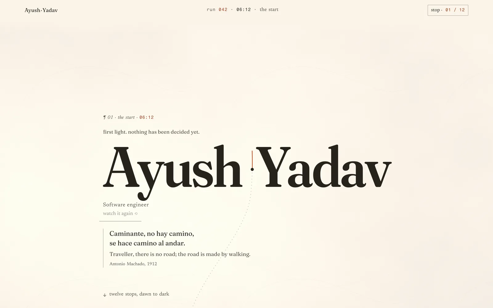
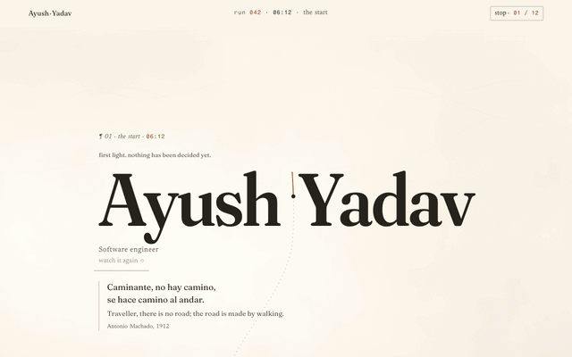
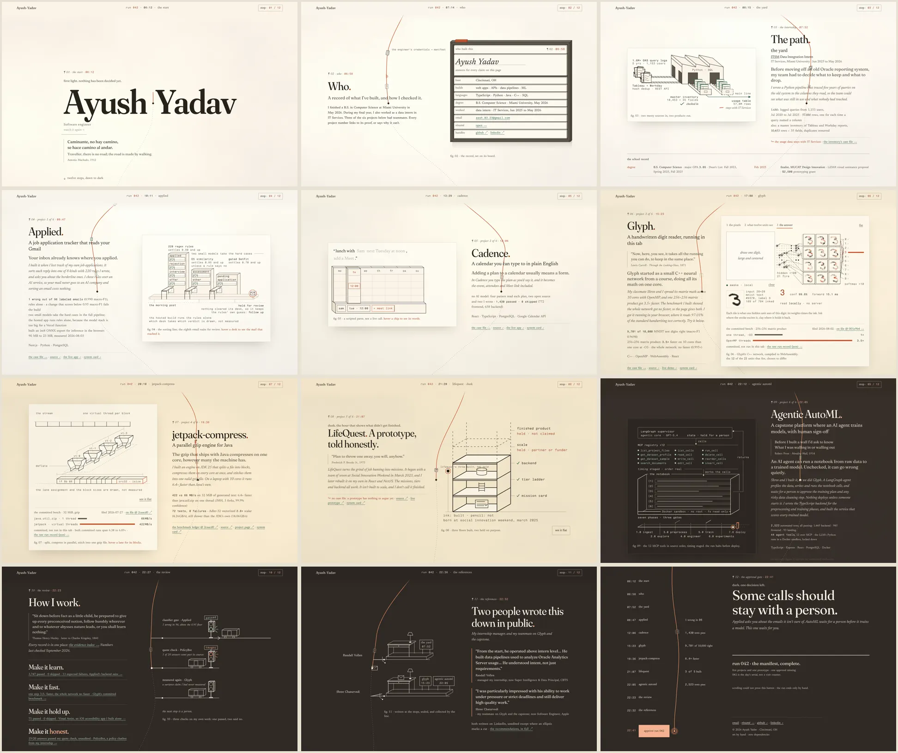
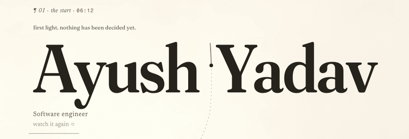
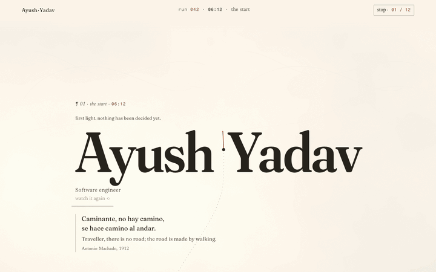
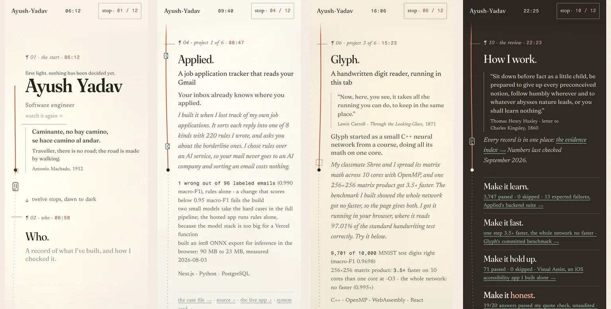
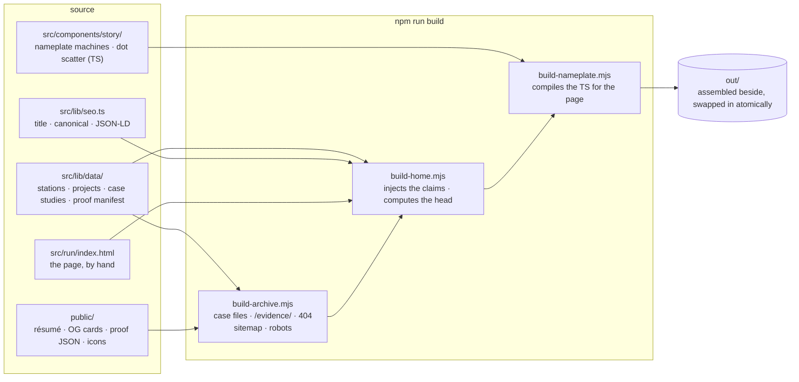
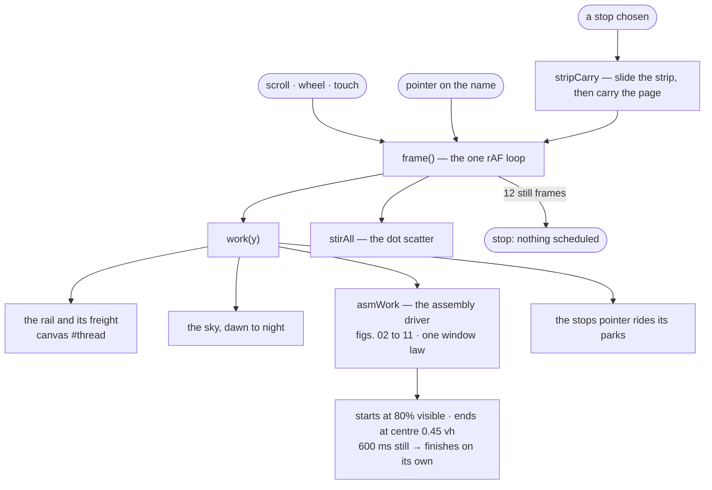
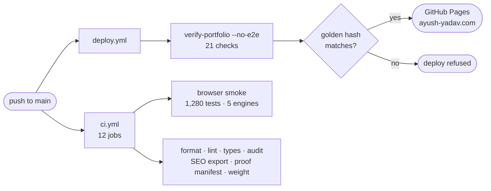

<div align="center">

# Ayush Yadav — the long run

**The portfolio of Ayush Yadav, software engineer.**
One workday drawn as a railway run: twelve stops from dawn to dark, and every number on the way links to the commit, benchmark file or CI run it came from.

[**ayush-yadav.com**](https://ayush-yadav.com/) · [résumé](https://ayush-yadav.com/resume.pdf) · [evidence index](https://ayush-yadav.com/evidence/) · [LinkedIn](https://www.linkedin.com/in/ayush-yadav-developer/)

[](https://github.com/yadava5/Portfolio-2.0/actions/workflows/ci.yml)
[](https://github.com/yadava5/Portfolio-2.0/actions/workflows/deploy.yml)


[](LICENSE)

<a href="https://ayush-yadav.com/"></a>

</div>

---

## The run

The page is one long scroll. A red rail runs through it, carrying freight between stations, and the sky goes from first light to night as you read. Each station is one part of the work: who I am, an internship, six projects, how I check my own work, two references, and a gate at the end that only a person can open.

<p align="center">
  
</p>

Every figure assembles with the scroll and finishes where it is read. Stop scrolling for 600 ms with a figure in view and it completes on its own, so nothing is ever left half built.

| ¶ | Clock | Station | What is there |
|---|---|---|---|
| 01 | 06:12 | the start | the nameplate, built by five letter machines |
| 02 | 06:58 | who | fig. 02 — the record card, set on its board |
| 03 | 07:52 | the internship | fig. 03 — five years of query logs and a master inventory, given shape |
| 04 | 08:47 | **Applied** — Gmail job tracker | fig. 04 — the sorting line: 220 rules, two small models, one email held for review |
| 05 | 12:06 | **Cadence** — calendar in plain English | fig. 05 — a typed plan parsed into the week, in depth |
| 06 | 15:23 | **Glyph** — digit reader in C++ | fig. 06 — a live neural network, compiled to WebAssembly; draw a digit and it reads it in your tab |
| 07 | 19:36 | **jetpack-compress** — parallel Java gzip | fig. 07 — split, compress on every core, stitch into one valid gzip |
| 08 | 21:07 | **LifeQuest** — prototype | fig. 08 — three floors built, two held on purpose |
| 09 | 22:05 | **Agentic AutoML** — capstone | fig. 09 — twelve MCP tools in source order, halting before deploy |
| 10 | 22:23 | the review | fig. 10 — three checks on my own work: one passed, two said no |
| 11 | 22:32 | the references | fig. 11 — two recommendations, quoted verbatim and linked |
| 12 | 22:41 | the approval gate | the manifest, and one button scrolling cannot press |

Behind the run sits a record room: seven case files at [`/projects/<id>/`](https://ayush-yadav.com/projects/jobtracker/) and an [`/evidence/`](https://ayush-yadav.com/evidence/) ledger, generated from the same data layer.

<p align="center">
  
</p>

## Things to try

**Sweep across the name.** Each letter breaks into dots that carry into the next one, then the roller prints the name back exactly as it was.

<p align="center">
  
</p>

**Open the stops.** The chip in the corner opens a timetable of all twelve stops. Pick one and the strip slides away, then the page carries you there and lands the station centred under the masthead.

<p align="center">
  
</p>

**Draw a digit at Glyph.** The network is the real one from [yadava5/glyph](https://github.com/yadava5/glyph), compiled to WebAssembly. It runs in your browser with no server.

**On a phone,** the layout drops to one column beside the rail. Nothing is shrunk to fit.

<p align="center">
  
</p>

## How it is built

There is no framework. The site is one hand-written HTML page (`src/run/index.html`, about 20,000 lines of HTML, CSS and vanilla JavaScript) and a static generator in plain Node that builds the archive around it. The only package installed for the build is [`sharp`](https://sharp.pixelplumbing.com/), for deriving images. The page loads nothing from anyone else.



`build-home.mjs` copies the page's engine and CSS byte for byte and replaces only content: every claim, receipt and case-file link comes from the data layer, and where the page's prose and the data disagree, the data wins. The whole site is assembled in a scratch directory and renamed into place in one step, so a failed build leaves the previous one standing.

At runtime there is one scroll loop, and it stops when the page is still: after twelve quiet frames nothing is scheduled, so leaving the tab open costs nothing.



More depth, including the window law, the carry and how the head is computed, is in [**docs/ARCHITECTURE.md**](docs/ARCHITECTURE.md).

## Run it

```bash
npm ci
NEXT_PUBLIC_BASE_PATH= npm run build   # writes out/
npm run preview                        # serves out/ at http://127.0.0.1:4300
```

The preview rewrites the deployed origin to its own in the HTML it serves, so links between the run and the case files stay local. Nothing on disk changes.

`NEXT_PUBLIC_BASE_PATH` is a name left over from a framework that is gone. It is still read (`src/lib/basePath.ts`) and is empty everywhere, because the site is served at the root of `ayush-yadav.com`.

## How it is checked

```bash
npm run verify:portfolio
```

Twenty-two checks in a fixed order, first failure stops: types, lint and format, the deploy build, the golden hash, sixteen gates on the built site, then the browser smoke. The deploy runs the same command without the browser step and refuses to ship on any red; CI runs the browser smoke on every push. The checking is more the point of this repository than the page is.



| Gate | What it refuses to let past |
|---|---|
| golden hash | the shipped page must reproduce byte for byte, pinned to the commit that produced it |
| pinned artifact links | every sha-pinned link into the project repositories must still resolve, on that repo's default branch |
| headline figures ⇄ data layer | no number appears in a figure that the data layer does not own |
| bench figures ⇄ their records | benchmark bars are fractions of committed JSON, not typed-in numbers |
| run ⇄ archive crosswalk | every rejoin, receipt anchor and quoted consignment agrees in five directions |
| stations ⇄ the run | the station table and the page cannot drift apart |
| cargo rides the right corridors | each waybill arrives at the station it is about |
| nameplate, and its negative | the name lands on its type; the guard is proven by making it fail in a throwaway copy |
| no dashes in visible text | a typographic rule, enforced on the built page |
| palette ⇄ the light it is read under | contrast is measured under the sky it sits on, day and night |

The browser smoke runs five spec files on Chromium, Firefox and WebKit, desktop and phone: 1,280 tests. Beside it are reduced motion, axe accessibility, performance budgets and static SEO, for 1,375 tests across nine spec files in all. Each gate in `scripts/qa/` opens with a header naming the defect that made it exist. See [**tests/playwright/README.md**](tests/playwright/README.md).

## Layout

```text
src/
├── run/index.html        the site, one hand-written page
├── run/fonts/            three self-hosted families, subset to Latin
├── run/wasm/             Glyph's classifier and its weights
├── lib/data/             the declared truth: stations, projects, case studies, proof
├── lib/seo.ts            the head and the JSON-LD graph
└── components/           the nameplate machines, the dot scatter, rail geometry

scripts/
├── archive/              the build, plain Node
├── run/                  the home page and nameplate emitters
├── qa/                   the gates, and verify-portfolio.mjs which runs them
├── asset-truth/          OG cards, favicons, derived images
├── resume/               the résumé render and its check
└── dev/preview.mjs       the local preview server

tests/playwright/         the browser specs
docs/                     architecture, rules and the design history (see docs/README.md)
public/                   copied into out/ as is
```

## License

This repository is **source available, not open source.** Read it, run it, learn from it and change it for yourself. Do not sell it.

- **The code and the design** are under the [PolyForm Noncommercial License 1.0.0](LICENSES/PolyForm-Noncommercial-1.0.0.md). Personal, educational and other noncommercial use is allowed; selling it, selling a template made from it, or using it for paid client work is not. Copies must keep the notice: *Copyright Ayush Yadav (https://ayush-yadav.com)*.
- **The personal content is not licensed at all:** my name and portrait, the résumé, the facts about my work in `src/lib/data/`, the written copy, the site mark and the social cards. A fork replaces them.
- **Third party material** keeps its own terms: the fonts are SIL OFL 1.1, the logos are their owners' trademarks, and the references are the words of the people quoted. See [LICENSES/NOTICE.md](LICENSES/NOTICE.md).

The full terms are in [LICENSE](LICENSE). For anything they do not cover, email me.

## Author

**Ayush Yadav** — software engineer. B.S. Computer Science, Miami University, May 2026. Cincinnati, Ohio.

[ayush-yadav.com](https://ayush-yadav.com/) · [GitHub](https://github.com/yadava5) · [LinkedIn](https://www.linkedin.com/in/ayush-yadav-developer/) · [aesh.03.23@gmail.com](mailto:aesh.03.23@gmail.com)
