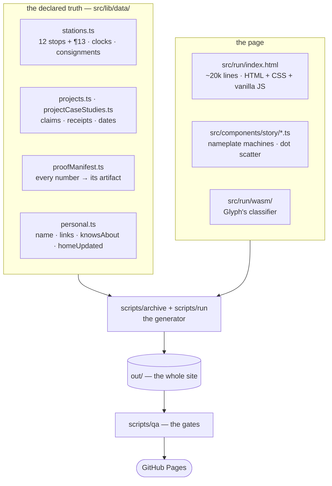
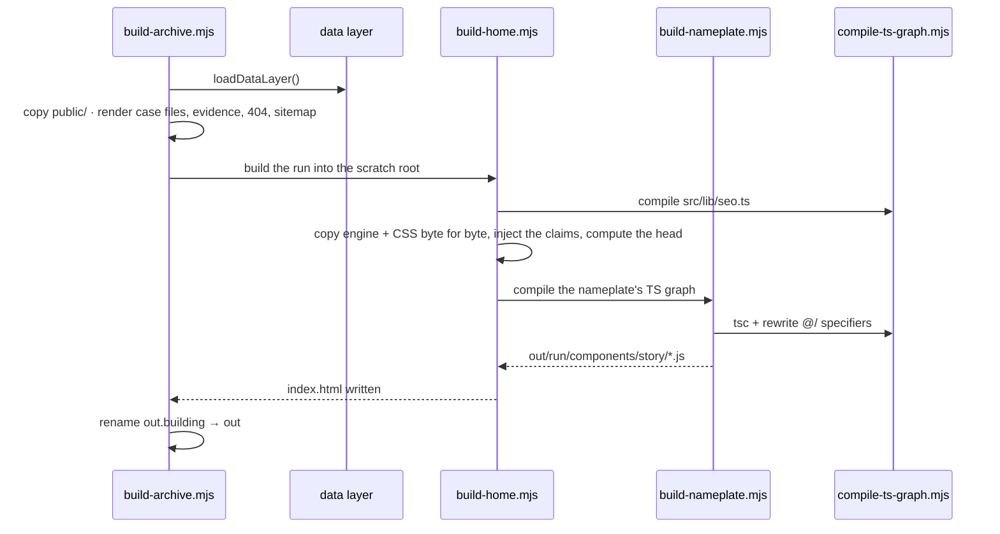
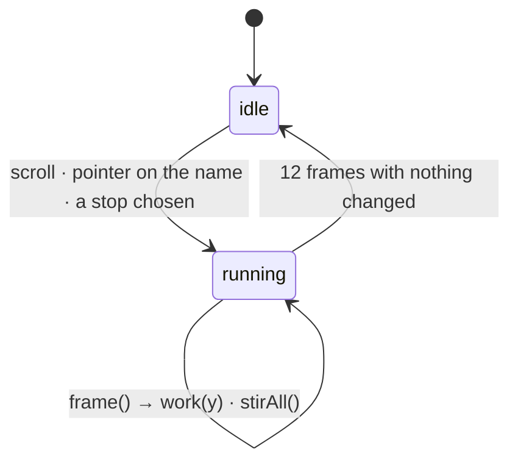
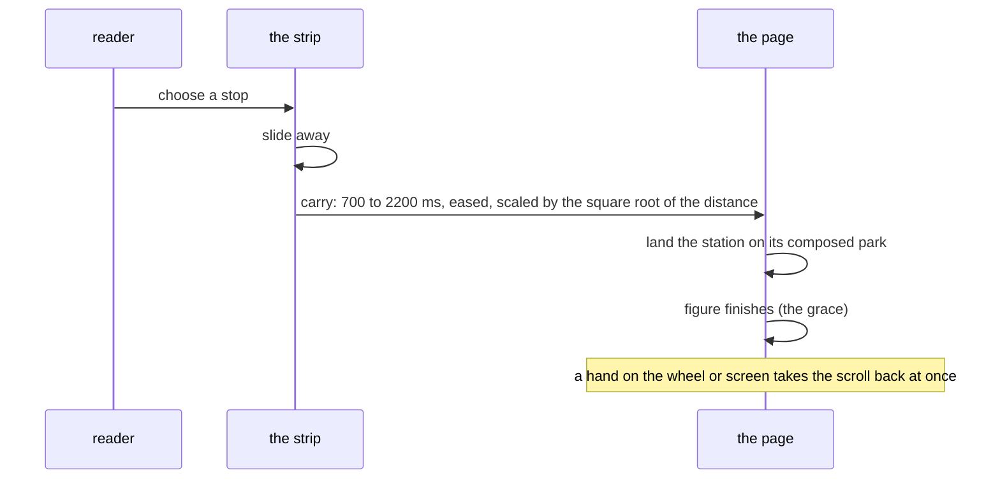
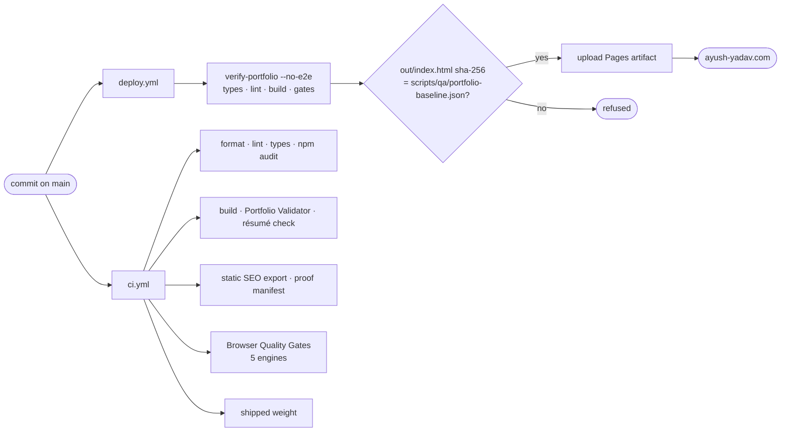

# Architecture

How [ayush-yadav.com](https://ayush-yadav.com/) is put together: what the source is, how the build turns it into a site, what the page does while you read it, and how a change gets from a commit to the domain. Line counts and constants below are read from the source at the time of writing; the source is the authority when they disagree.

## The shape of it

Two things are deliberate and everything else follows from them:

1. **The page is hand-written, and the facts are not.** `src/run/index.html` is the approved design, kept as one file. The claims on it — numbers, receipts, dates, case-file links — come from `src/lib/data/` at build time. Where the page's prose and the data disagree, the data wins and the build says so.
2. **Every number terminates in something you can open.** A commit, a benchmark JSON, a CI run. The gates check that each link still resolves and that each figure is the one its record holds.

## The build

`npm run build` runs `scripts/archive/build-archive.mjs`. Its step order is the contract:

| Step | What happens |
|---|---|
| 0 | load the data layer, before anything on disk is touched |
| 1 | create a scratch root beside `out/` (`out.building`) |
| 2 | copy `public/` — résumé, OG cards, favicons, the proof records |
| 3 | emit `/projects/<id>/` × 7, `/evidence/`, `404.html`, `sitemap.xml`, `robots.txt` |
| 4 | call `scripts/run/build-home.mjs`, which writes the run over `index.html` |
| 5 | rename the finished root into place |

Assembling beside the output and renaming it means a failure leaves the previous build serving, never a half-written one. `--out <dir>` emits a complete second copy, which is where every negative test runs, so a gate is never proven by breaking the directory someone is looking at.

### The head

`build-home.mjs` computes the `<head>` from `src/lib/seo.ts` rather than trusting what the hand-written file carries: title, description, canonical, Open Graph card, and one JSON-LD graph of `ProfilePage`, `Person` and `WebSite`. The `Person` carries `givenName`, `familyName`, `knowsAbout` and `sameAs` (only profiles the page itself links). `siteMetadata.homeUpdated` in `personal.ts` drives both the page's `dateModified` and the home entry's `<lastmod>` in `sitemap.xml`, and the sitemap build throws on a malformed date.

### The nameplate

The run cannot import TypeScript, but it needs the same letter machines as the source in `src/components/story/nameplateMachines.ts`. `build-nameplate.mjs` compiles that module graph with `tsc` and rewrites its `@/…` specifiers so a browser can load it. The run gets a generated artifact, never a second hand-kept copy.

## The page at runtime

### One loop, and it stops

Everything that moves goes through `frame()`, one `requestAnimationFrame` loop. It calls `work(y)` when the scroll position changed, `stirAll()` while a hand is on the name, and leads with the stops carry when one is in flight. After twelve frames with nothing changed it returns without scheduling another, so an idle tab costs nothing. The browser smoke asserts this directly by counting `requestAnimationFrame` calls on a still page.

`work(y)` draws, from the one scroll position:

- **the rail** — a canvas (`#thread`) that runs the length of the page, with freight riding each corridor under a waybill that names what it carries;
- **the sky** — the page's own colour from first light to night;
- **the assembly driver** — figs. 02 to 11;
- **the stops pointer** — which rides the stations' parks, not the clock.

### The assembly driver and its window law

Each figure registers with `asmFigure(key, { box, draw, window, span })`. The driver maps the figure's position on screen to a progress `p` from 0 to 1 and follows it with a spring, so a steady scroll is followed about 0.11 s behind and no motion runs faster than its rate limit.

| Constant | Value | Meaning |
|---|---|---|
| `ASM_START` | 0.8 | `p = 0` until 80% of the drawing is on screen; nothing starts below the fold |
| `ASM_END` | 0.45 vh | `p = 1` when the drawing's centre reaches 45% down the screen, where a figure is read |
| `ASM_GRACE` | 600 ms | stop scrolling this long with the figure in view and it finishes on its own |
| `ASM_EYE` | 0.70 vh | the grace needs the centre at or above this; a stop at the fold is not a park |
| `ASM_SEEN` | 0.9 | and 90% of the drawing in view |
| `ASM_JUMP` | 0.3 vh | a scroll this far in one frame is a jump, and lands at once |

Under `prefers-reduced-motion` every figure arrives complete and nothing waits to be scrolled into.

### The stops

The chip in the corner (`#mtoggle`) opens `#manifest`, a timetable of the twelve stops that runs from light to dark like the page. Choosing one runs `stripCarry`:

A park is computed by `stripParks`, the same function that places the pointer, so the two cannot disagree. A station that fits between the masthead's scrim and 24 px above the bottom sits at the band's optical centre (0.42); a taller one starts 12 px under the scrim.

### The name

At rest the nameplate is live text. A pointer on it hands the letters to `nameScatter.ts`: each letter is cut into dots from a raster of itself, the dots fly with the hand and knock on into the letters beside them, and 360 ms after the hand lets go a roller prints the name back. The canvas is clamped to its section and the viewport, so the scatter never widens the page. The assembly machines run once on load and again only from "watch it again"; the hover never replays them.

### Glyph

The digit pad at ¶06 is backed by `src/run/wasm/fast_mnist.js`, which the page imports as it boots. It is Glyph's own network ([yadava5/glyph](https://github.com/yadava5/glyph)), compiled to WebAssembly with Emscripten, with its weights in `model.weights.bin`. Nothing is sent to a server.

## From a commit to the domain

**The golden hash.** `scripts/qa/portfolio-baseline.json` records the sha-256 and size of `out/index.html` and the commit that produced them. A deploy builds the page again and refuses to ship if it does not reproduce byte for byte. Changing the page means recording a new golden with `node scripts/qa/verify-portfolio.mjs --rebaseline --no-e2e`, in a commit of its own, so the pinned sha stays reachable.

**The domain.** GitHub Pages serves the site from `public/CNAME`. How DNS, HTTPS and the move from the old project-page URL were wired is in [DOMAIN-MIGRATION.md](DOMAIN-MIGRATION.md).

## Where to look

| To change | Start at |
|---|---|
| a number, a date, a claim | `src/lib/data/` — then run `npm run test:figures` |
| a station's words or figure | `src/run/index.html`, by its `<section id>` |
| the head, the JSON-LD, the sitemap | `src/lib/seo.ts`, `src/lib/data/personal.ts`, `scripts/archive/sitemap.mjs` |
| a case file or the evidence index | `scripts/archive/render-case-file.mjs`, `render-evidence.mjs` |
| the name's hover | `src/components/story/nameScatter.ts` |
| a gate | `scripts/qa/`, each file's header says what defect it exists for |
